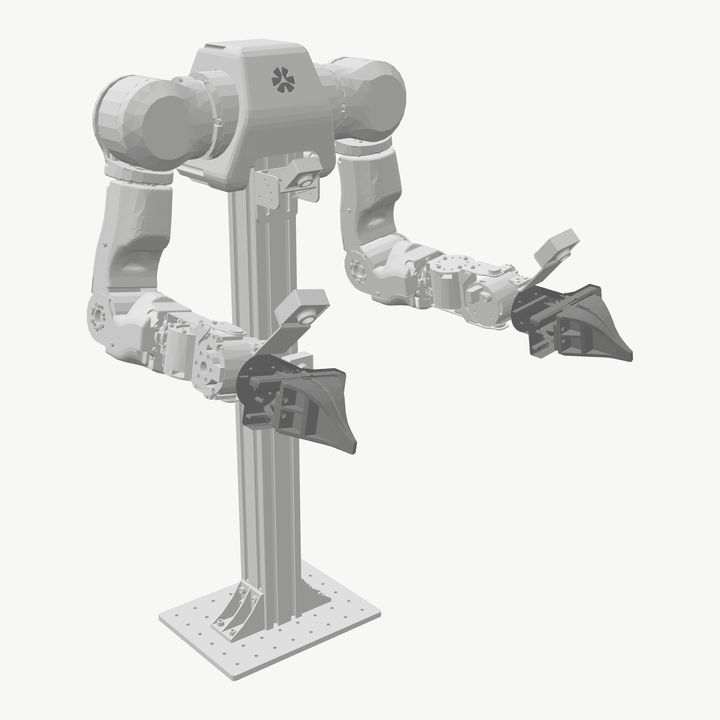
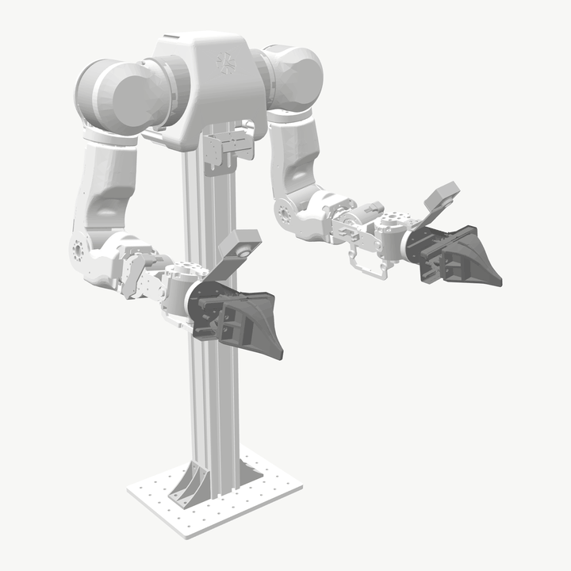
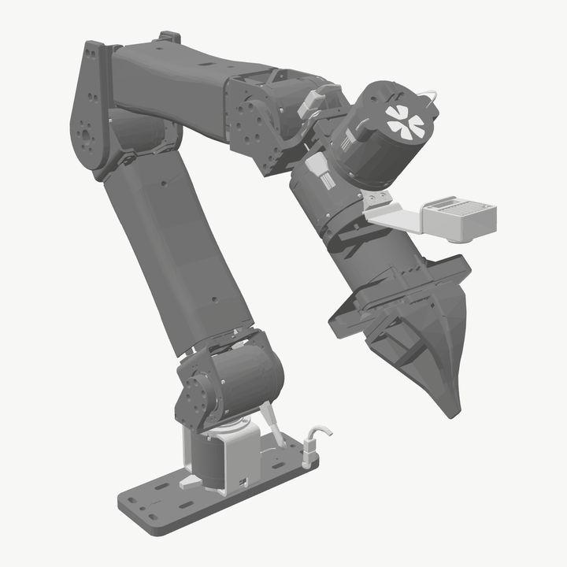
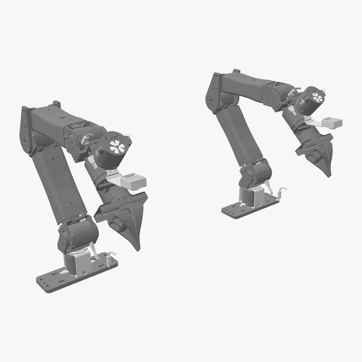
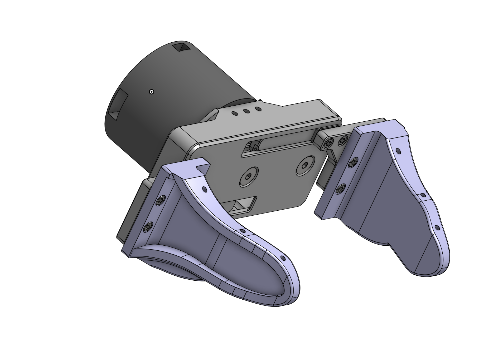

# Anvil hardware

URDF and MuJoCo models of Anvil's robots, the Anvil gripper with its CAD, and camera intrinsics and extrinsics.

| [OpenArm v1](openarm-v1) | [OpenArm v2](openarm-v2) | [OpenYAM](openyam) | [OpenYAM bimanual](openyam) | [Anvil gripper](anvil-gripper) |
|:---:|:---:|:---:|:---:|:---:|
|  |  |  |  |  |

## Models

| | URDF | MuJoCo | Camera extrinsics |
|---|---|---|---|
| OpenArm v1 | [`openarm-v1.urdf`](openarm-v1/openarm-v1.urdf) | [`openarm-v1.xml`](openarm-v1/openarm-v1.xml) | [`openarm-v1-cameras.yaml`](openarm-v1/openarm-v1-cameras.yaml) |
| OpenArm v2 | [`openarm-v2.urdf`](openarm-v2/openarm-v2.urdf) | [`openarm-v2.xml`](openarm-v2/openarm-v2.xml) | [`openarm-v2-cameras.yaml`](openarm-v2/openarm-v2-cameras.yaml) |
| OpenYAM | [`openyam.urdf`](openyam/openyam.urdf) | [`openyam.xml`](openyam/openyam.xml) | [`openyam-cameras.yaml`](openyam/openyam-cameras.yaml) |
| OpenYAM bimanual | [`openyam-bimanual.urdf`](openyam/openyam-bimanual.urdf) | [`openyam-bimanual.xml`](openyam/openyam-bimanual.xml) | [`openyam-bimanual-cameras.yaml`](openyam/openyam-bimanual-cameras.yaml) |
| Anvil gripper | [`anvil-gripper.urdf`](anvil-gripper/anvil-gripper.urdf) | [`anvil-gripper.xml`](anvil-gripper/anvil-gripper.xml) | [`anvil-gripper-cameras.yaml`](anvil-gripper/anvil-gripper-cameras.yaml) |

Each model's meshes are in the `meshes/` folder beside it. Units are meters and radians.

## Cameras

**Intrinsics** are per lens, in [`anvil-camera-intrinsics/`](anvil-camera-intrinsics), at 1920×1080 as ROS
`camera_info`: [standard](anvil-camera-intrinsics/standard-1920x1080.yaml),
[pseudo-fisheye](anvil-camera-intrinsics/pseudo-fisheye-1920x1080.yaml) and
[fisheye](anvil-camera-intrinsics/fisheye-1920x1080.yaml).

**Extrinsics** are per robot, in its `-cameras.yaml` above: the pose of each camera on the robot. The same cameras are
the `*_cam` links of its URDF.

| | Cameras |
|---|---|
| OpenArm v1, v2 | `chest_cam`, `waist_cam`, `left_wrist_cam`, `right_wrist_cam` |
| OpenYAM | `wrist_cam` |
| OpenYAM bimanual | `pole_cam`, `left_wrist_cam`, `right_wrist_cam` |
| Anvil gripper | `wrist_cam` |

## Gripper CAD

STEP files of the gripper and its finger sets are in [`anvil-gripper/cad/`](anvil-gripper/cad).

## License

Apache-2.0 ([`LICENSE`](LICENSE)), except the gripper's CAD in [`anvil-gripper/cad/`](anvil-gripper/cad), which is
CERN-OHL-S-2.0 ([`LICENSE`](anvil-gripper/cad/LICENSE)).
