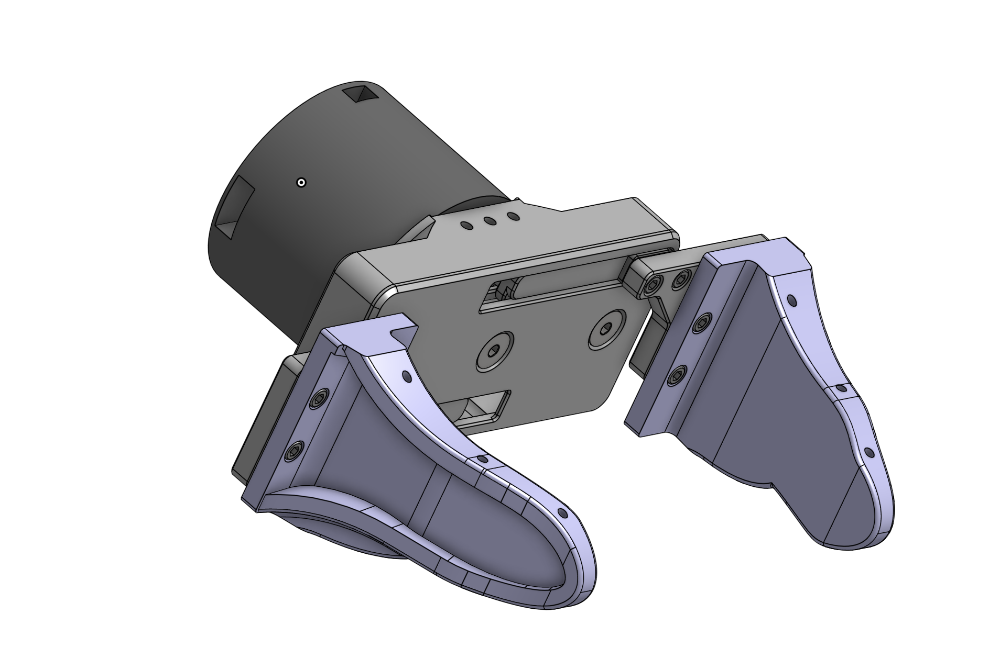
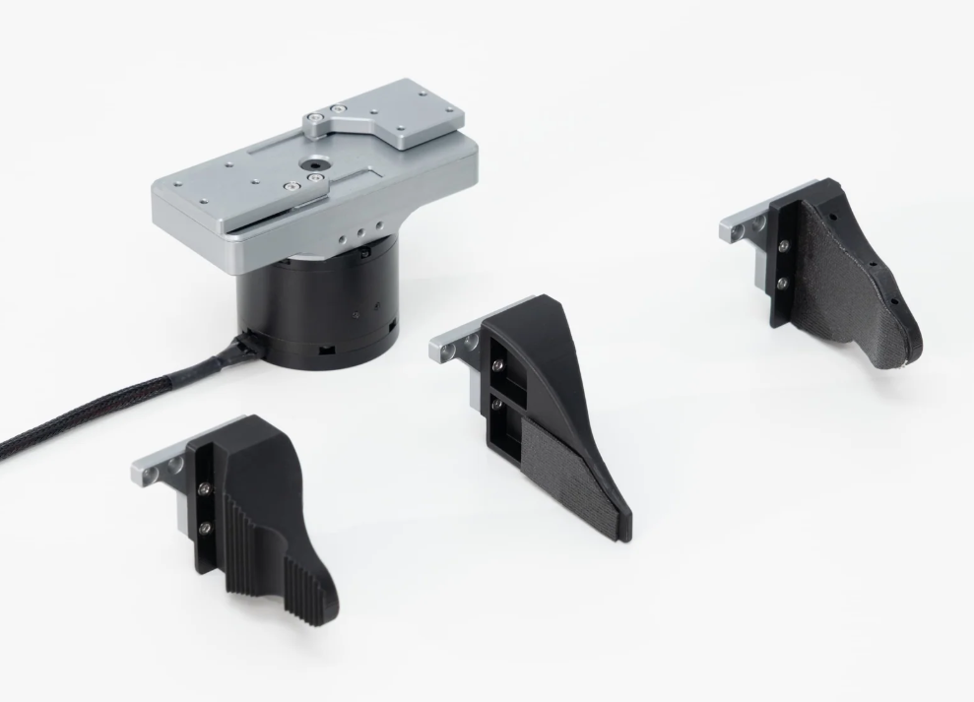

# Anvil Gripper

`anvil-gripper.urdf` and `anvil-gripper.xml` are the gripper on its own, with the fine-tip fingers, rooted at `hand`,
the face it bolts to an arm by.

## Gripper Fingers

We include 3D files for four different types of gripper fingers:

- 1 pair of fine-tip flange
- 1 pair of wide-tip flange
- 1 pair of toothed flange
- 1 pair of hollow jaw flange (L/R reversible)

## CAD Files

All CAD files, STEP format, are in [`cad/`](cad):

- `gripper-base.stp`
- `left-finger-mount.stp`
- `right-finger-mount.stp`
- `wide-tip-flange-left.stp`
- `wide-tip-flange-right.stp`
- `fine-tip-flange-left.stp`
- `fine-tip-flange-right.stp`
- `toothed-flange-left.stp`
- `toothed-flange-right.stp`
- `hollow-jaw-flange.stp`
- `camera.stp`

## Online Viewer

[Check out the models online here](https://cad.onshape.com/documents/a4ea09ac891d3e7a10ca9128/w/d988c9d914d08a3f387bc9c2/e/584ae1d20b0bc3b6434ee4dd?renderMode=0&uiState=69e145c594e20a041f8c7513)

## License

The CAD files in [`cad/`](cad) are under the CERN Open Hardware License Version 2 - Strongly Reciprocal
([`cad/LICENSE`](cad/LICENSE)). The URDF, MJCF and meshes are Apache-2.0, as the rest of this repository.

Copyright 2026 Anvil Robotics
